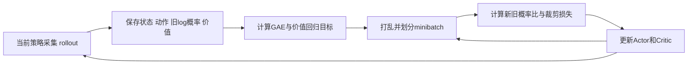

# 算法原理对照

记 `d` 为真正终止标志，gamma 为折扣。回报是未来奖励的折扣和，价值是回报的条件期望。`V(s)` 评价状态，`Q(s,a)` 评价状态中的动作。策略 `pi(a|s)` 给出动作分布。

| 方法 | 学习目标的核心 | 数据 | 本仓库入口 |
|---|---|---|---|
| 价值迭代 | `max_a E[r + gamma*(1-d)*V(s')]` | 已知转移模型 | `02_value_iteration.solve` |
| SARSA | `r + gamma*(1-d)*Q(s',a')` | 当前探索策略 | `03_td_control.td_target` |
| Q-learning | `r + gamma*(1-d)*max Q(s',.)` | 可离策略 | 同上 |
| DQN | Q-learning 目标，Q 换成网络 | 回放池 | `04_dqn.main` |
| Double DQN | 在线选动作，目标网络评动作 | 回放池 | 同上 |
| REINFORCE | `-log pi(a|s) * G` | 完整轨迹 | `05_policy_gradient.main` |
| 一步 AC | `-log pi(a|s) * detach(delta)` | 最新转移 | 同上 |
| PPO | `-min(ratio*A, clip(ratio)*A)` | 新 rollout 内多轮更新 | `06_ppo.main` |
| DDPG | Actor 最大化 `Q(s,mu(s))` | 回放池 | `07_continuous.main` |
| TD3 | 双 Q 最小目标、延迟更新、目标平滑 | 回放池 | 同上 |
| SAC | Actor 最小化 `alpha*log pi - min Q` | 回放池 | 同上 |

这些方法的推导对应 [Hands-on-RL](https://hrl.boyuai.com/chapter/) 与 [Spinning Up 算法目录](https://spinningup.openai.com/en/latest/user/algorithms.html)。

## 数值更新

若 `Q(s,a)=2`、`r=1`、`max Q(s',.)=4`、gamma=0.9、学习率=0.1，Q-learning 目标为 4.6，更新后为 2.26。如果下一步实际动作的值是 1，则 SARSA 目标为 1.9，更新后为 1.99。终止时两者目标均为即时奖励 1。

DQN 最小化预测 Q 与固定 TD 目标之间的损失。本地使用 Huber 损失和梯度裁剪。Double DQN 目标中的动作来自 `argmax Q_online(s',.)`，再交给目标网络估值。

一步 AC 中 `delta = r + gamma*(1-d)*V(s') - V(s)`。Critic 通过回归目标改善价值估计，Actor 用被分离梯度的 delta 调整动作概率。估计准确时，delta 是优势的样本估计。

## PPO 的数据流

`delta_t = r_t + gamma*(1-terminated_t)*V(s_{t+1}) - V(s_t)`。

`A_t = delta_t + gamma*lambda*(1-boundary_t)*A_{t+1}`，其中 `boundary = terminated or truncated`。在 rollout 末尾，递推尾项置零，但最后转移的 delta 仍包含有效下一状态价值。

PPO 裁剪抑制过大概率变化带来的部分优化收益，并非对全部策略变化的硬约束。本地版本省略 KL 提前停止、学习率退火与价值裁剪。核对 [Spinning Up PPO](https://spinningup.openai.com/en/latest/algorithms/ppo.html)。

## 连续动作的三个目标

DDPG 的 Critic 目标为 `r + gamma*(1-d)*Q_target(s',mu_target(s'))`。

TD3 把上式替换为两个目标 Critic 的较小值，在目标动作上加入截断噪声，并降低 Actor 与目标网络更新频率。Actor 仍使用第一个 Critic 的梯度。核对 [TD3 方程](https://spinningup.openai.com/en/latest/algorithms/td3.html)。

SAC 的目标为 `r + gamma*(1-d)*(min Q_target(s',a') - alpha*log pi(a'|s'))`，其中 a' 从当前策略采样。本地固定温度 0.2。Actor 使用重参数采样 `rsample()`，通过 Critic 对动作的梯度更新参数。核对 [SAC 方程](https://spinningup.openai.com/en/latest/algorithms/sac.html)。

Pendulum 动作 `a = 2*tanh(u)`。因此动作密度要从高斯潜变量密度中减去 `log(2*(1-tanh(u)^2))`，代码加入小常数避免对零取对数。这里的 2 是环境动作缩放。当前网络与维数专门对应 Pendulum。
