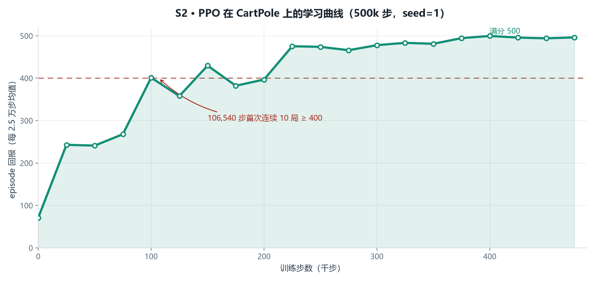
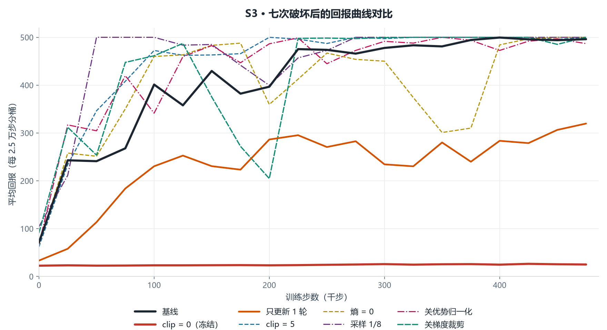
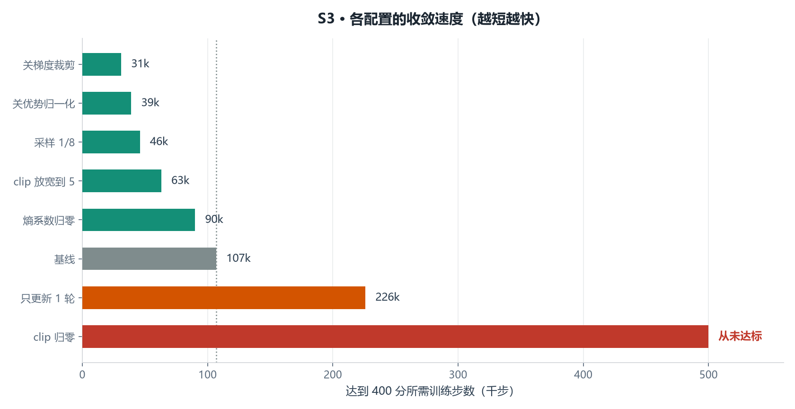
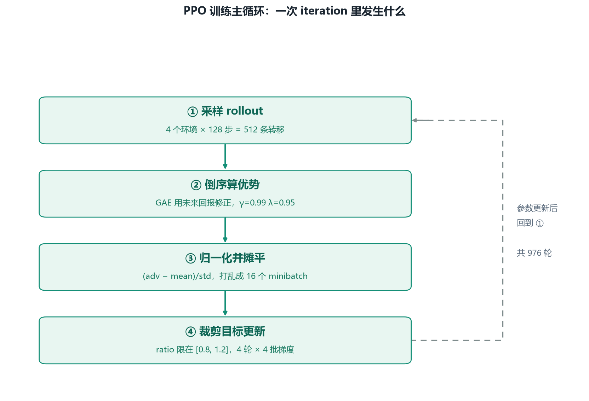
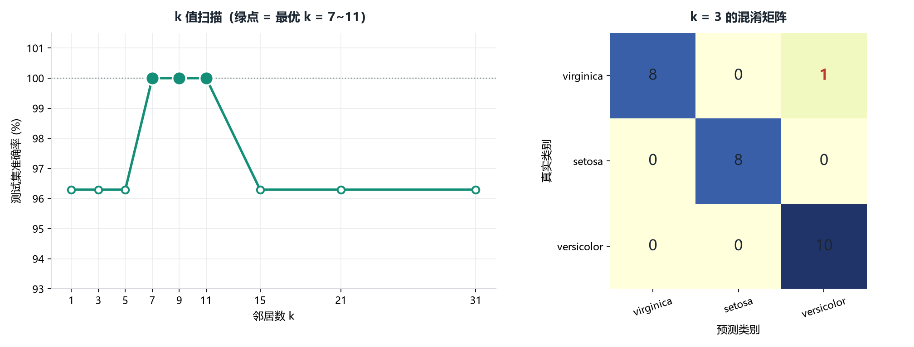
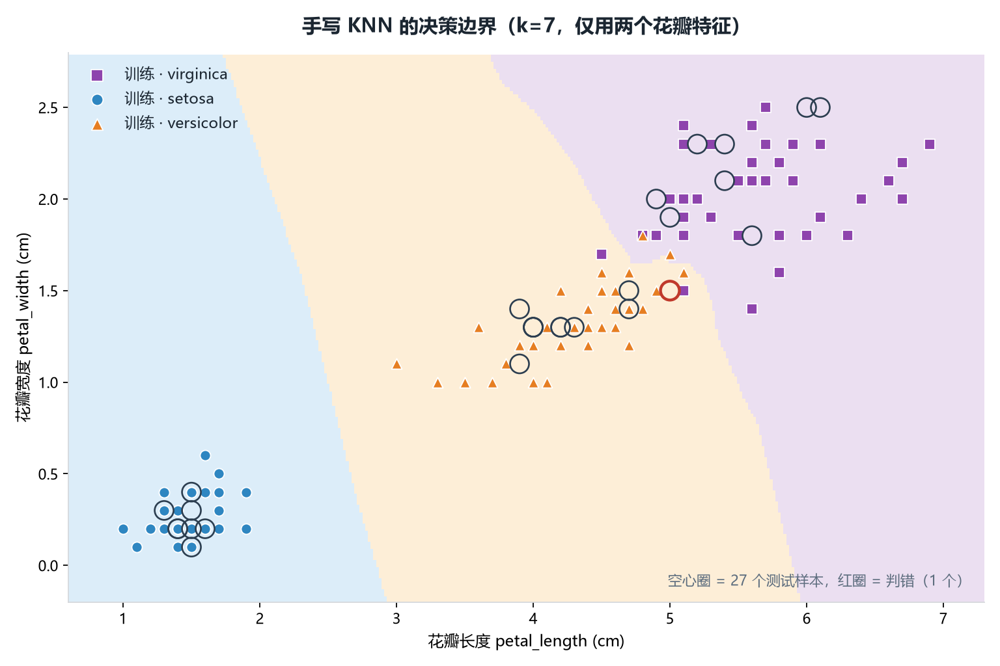

# PPO 复现报告 · S2–S4

> **项目**：强化学习复现（对齐 11.15 节点）
> **环境**：CartPole-v1 · CleanRL PPO 参考实现 · gymnasium 1.4.0 · torch 2.9.1+cu128
> **日期**：2026-10-27　**数据**：`logs/S3_results.md`、`logs/S3_0*.log`

**一句话结论**：PPO 的稳定化组件是复杂任务的保险，不是简单任务的必需品 —— 七次破坏里有四次反而更快。

**另附**：两天前手写实现的一份 KNN 分类器（第九节），作为「监督学习 vs 强化学习」的范式对照。

---

## 一、总览

| 指标 | 数值 | 说明 |
|---|---|---|
| 训练总步数 | 500,000 | 9 组实验，每组 976 次迭代 |
| 基线最终回报 | 500 | 满分，末 10 局无一失手 |
| 基线收敛步数 | 106,540 | 首次连续 10 局 ≥ 400 |
| 单次训练耗时 | 4′51″ | 稳态约 1670 步/秒 |
| 参数规模 | 2 × (4→64→64→2) | actor 与 critic 各一个两层 MLP |

---

## 二、S2 · 先确认它能学会

50 万步、1523 局，回报从 71 爬到满分。这条曲线是后面所有对比的基准线。



### 三个阶段

| 阶段 | 步数区间 | 发生了什么 | 数据依据 |
|---|---|---|---|
| 学会短期平衡 | 0 – 10 万 | 从乱试变成有偏好 | 回报 71 → 401，策略熵 0.692 → 0.508 |
| 震荡爬升 | 10 – 37.5 万 | 会平衡但会崩 | 价值网络解释方差在 −0.08 到 0.63 间剧烈波动 |
| 锁定满分 | 37.5 万后 | 已无更新空间 | 近端 KL 与裁剪比例双双归零 |

### 踩过的坑：gymnasium 1.4.0 与 CleanRL 不兼容

**症状**：程序跑到底不报错，但终端**一条 `episodic_return` 都没有**，TensorBoard 里 `charts/episodic_return` 完全空白。

**根因**：`ppo.py:210` 的判断是 gymnasium 0.2x 时代的 API。

```python
if "final_info" in infos:      # ← 在 gymnasium 1.4.0 下恒为 False
```

新版向量环境不再返回 `final_info` 键，改为 `infos["episode"]` 批量字典 + `infos["_episode"]` 布尔掩码。实测某步两个子环境同时终止时：

```
infos = {'episode': {'r': array([10., 10.]), '_r': array([True, True]), ...},
         '_episode': array([True, True])}
terminations = array([True, True])
```

**修法**：改用掩码逐环境取回报。

```python
if "episode" in infos:
    for _i in np.flatnonzero(infos["_episode"]):
        ep_r = float(infos["episode"]["r"][_i])
        ep_l = int(infos["episode"]["l"][_i])
        print(f"global_step={global_step}, episodic_return={ep_r}")
        writer.add_scalar("charts/episodic_return", ep_r, global_step)
        writer.add_scalar("charts/episodic_length", ep_l, global_step)
```

**为什么值得记一笔**：这是「照开源代码跑」最典型的失败模式 —— 不报错、能跑完、有输出，但输出是错的。只看终端会以为一切正常。

⚠️ `ref/` 在 `.gitignore` 里，重新 clone cleanrl 后补丁会丢，需重打。

---

## 三、S3 · 七次破坏

每次只动一个参数，其余全部锁定，seed 固定为 1，全程 50 万步。

判据用两个：**达标步数**（多快学会）和**途中最低点**（过程中崩没崩）。





### 完整数据

| 配置 | 达标步数 | 末 10 局 | 后 25 万步均值 | 途中最低 | 判定 |
|---|---|---|---|---|---|
| 基线（不改） | 106,540 | 500.0 | 485.9 | 241.0 | 基准 |
| clip = 0 | **从未达标** | **24.9** | **25.3** | 22.5 | **完全冻结** |
| clip = 5（极松） | 62,992 | 500.0 | 497.9 | 233.6 | 快 1.7 倍 |
| 熵系数 = 0 | 89,816 | 500.0 | **419.3** | 251.4 | 先快后崩 |
| 采样 1/8 | 45,832 | 500.0 | 497.1 | 211.4 | 快 2.3 倍 |
| 只更新 1 轮 | 226,140 | **331.3** | 269.5 | 57.9 | **真实退化** |
| 关优势归一化 | 38,884 | 500.0 | 483.4 | 304.6 | 快 2.7 倍 |
| 关梯度裁剪 | **31,184** | 500.0 | 498.0 | **204.7** | 快 3.4 倍 |

> 「途中最低」= 第 2.5 万步之后所有分桶均值的最小值，用来衡量训练过程是否崩过。

### 逐条分析

#### 1. clip = 0 —— 唯一真正致命的改动

- **现象**：跑了 19,841 局（基线的 13 倍，因为每局 20 步就倒），最高只到 145 分，50 万步从头到尾没碰过 400。
- **机理**：`clamp(ratio, 1-0, 1+0)` 把区间压成 `[1,1]`，`ratio` 恒等于 1，`pg_loss2 = -mb_advantages` 与 ratio 完全脱钩，`torch.max()` 恒取第二项，**对策略参数的梯度精确等于 0**。
- **结论**：这不是「关掉约束」，是「关掉更新」。拆掉安全带和拆掉油门是两回事，这条是拆掉了油门。

#### 2. clip = 5 —— 反而比基线快 40%

- **现象**：62,992 步达标，后 25 万步均值 497.9，曲线平稳无崩盘。
- **机理**：clamp 区间 `[-4, 6]`，实际永不触发，退化成带 GAE 的原始策略梯度。
- **结论**：在 CartPole 上，信任域约束是纯负担。

#### 3. 熵系数 = 0 —— 先快后崩再恢复

- **现象**：89,816 步达标（略快于基线），但 20–37.5 万步之间从 487 掉到 **301**，之后才爬回 500。后 25 万均值 419.3，是所有能达标实验里最低的。
- **机理**：熵项消失后随机性只降不升，策略过早收敛到某个局部解；崩盘期正是它在脱离那个局部解。
- **结论**：熵项是**防崩保险**，不是提分手段。代价不在终点分数，在训练过程的稳定性。

#### 4. 采样 1/8 —— 前期最猛，中期反复

- **现象**：45,832 步达标（第 3 快），5–7.5 万步就摸到 500；但 17.5–25 万步掉到 399.6。
- **机理**：每轮只有 64 条数据却做 16 次梯度更新，单步更新噪声极大 —— 进步快，方向也偏。
- **代价**：iteration 从 976 涨到 7812，耗时 23 分钟（并行条件下），SPS 掉到 362。

#### 5. 只更新 1 轮 —— 唯一符合教科书预期的退化

- **现象**：226,140 步才达标（基线的 2.1 倍），末 10 局仅 331.3，全程在 230–320 徘徊爬不上去。
- **机理**：同样 512 条数据从「用 4 遍」变成「用 1 遍」，样本效率掉到四分之一。
- **验证**：226k ÷ 107k ≈ 2.1，扣掉前期快速上升期的稀释，与理论基本吻合。
- **结论**：**这一条才是真正的性能退化**，而且纯慢、不崩、可预测。

#### 6. 关优势归一化 —— 第二快

- **现象**：38,884 步达标（2.7 倍速度），后 25 万均值 483.4（略低于基线）。
- **机理**：CartPole 奖励恒为 +1，回报范围 10–500，优势数值本身就在正常量级，归一化带来的增益有限。
- **注意**：换到 FJSP 这种 makespan 上百、奖励尺度不均的任务，归一化大概率会变成必需项。**不能直接搬结论。**

#### 7. 关梯度裁剪 —— 最快，但也崩过

- **现象**：31,184 步达标（3.4 倍速度），后 25 万均值 498.0 最高；但 17.5–25 万步从 487 暴跌到 **204.7**，之后自行恢复。
- **机理**：梯度裁剪是防止单次尖峰更新把网络打飞的保险。去掉后学习更快，代价是偶尔真被打飞。
- **结论**：速度与稳定在这一项上是明确的此消彼长。

### 方法论收获：只看终点会被骗

七条里有六条最后都是 500 分。**如果只填「末 10 局均值」这一列，会得出「动什么参数都无所谓」的错误结论。**

必须加一列「途中最低点」，才能区分它们。

| 配置 | 达标速度 | 途中最低点 |
|---|---|---|
| 关梯度裁剪 | 31k（最快） | **204.7** |
| 采样 1/8 | 46k | 399.6 |
| 熵归零 | 90k | **301.0** |
| 基线 | 107k | 357.8（全程平滑） |

最快的配置崩到 204 分然后自己恢复了。基线最慢，但一条平滑的斜线。

---

## 四、三条结论

### 结论一：破坏不等于变差

七条里除了 clip = 0 和只更新 1 轮，其余五条全部在 50 万步内达标，其中**四条比基线快 1.7 到 3.4 倍**。

不是 PPO 设计错了。这些组件是为高维观测、稀疏奖励、大网络准备的稳定器。CartPole 只有 4 维状态、2 个动作、奖励恒定，稳定器拦掉的都是本可以加快进度的更新。

### 结论二：速度与稳定此消彼长

最快的中途崩了，最慢的全稳。这两个维度在本次实验里明确是反向的。

### 结论三：clip 不能动，但理由反直觉

教科书说 clip 是 PPO 的核心。实测给出的真实原因是：`clip_coef = 0` 会让 `ratio` 被压成常数 1，**梯度精确归零**。这是实现层面的自杀，不是理论层面的必需。放宽到 5.0 反而快 40%。

> **「PPO 里最不能动的是 clip 系数，因为它一旦设成 0，ratio 被压成常数、梯度直接消失、策略从头到尾学不会任何东西；但除此之外，其余四个稳定化组件在这个简单任务上去掉后反而更快 —— 说明它们是复杂任务的保险，不是简单任务的必需品。」**
>
> —— S3 要求的一句话结论

---

## 五、S4 · 原理拆解

### 一句话版本

PPO 只做一件事：**反复让当前策略下场试跑，再重点加强那些表现好的动作。每一次试跑都不是结果，是证据。**



### 四个阶段

**① 采样 rollout（`ppo.py:192-219`）**

策略网络对当前观测输出 2 个 logits（向左、向右），softmax 成概率，依概率采样一个动作。动作交给环境，拿回新观测、奖励、是否结束。每一步往 6 个张量里写一行：`obs / actions / logprobs / rewards / dones / values`。

一个 iteration = 128 步 × 4 环境 = 512 条转移。

**② 倒序算优势（`ppo.py:221-243`）**

`A = 折扣回报 − V(s)`。直觉是：这一步比你的预期好多少。优势为正说明这动作值得加强，为负说明下次要降低概率。

必须从第 128 步往回递推，因为每一步的优势都要用到后面那些步的优势。

**③ 归一化并摊平（`ppo.py:237-252`）**

把 512 条优势标准化成均值 0、方差 1。不做这一步，优势的绝对量级会随奖励尺度漂移，梯度跟着漂。然后打散 —— 连续 128 步来自同一条轨迹高度相关，不打乱等于每批都在学同一种情况。

**④ 裁剪目标更新（`ppo.py:254-297`）**

`ratio = exp(logπ_new − logπ_old)`，是「新策略做这个动作的概率比起旧策略涨了多少倍」。裁在 `[0.8, 1.2]`：

```python
pg_loss = torch.max(-adv * ratio, -adv * torch.clamp(ratio, 0.8, 1.2)).mean()
```

意思：你可以在旧策略基础上改进，但一步不许迈太大。同一批 512 条数据反复使用 4 轮 × 4 批 = 16 次梯度更新。**这就是 PPO 敢用旧数据多轮更新的全部底气** —— REINFORCE 没有这个约束，多轮必崩。

### 三个必答问题

**Q1：`logprobs` 为什么必须在更新前存好？**

它是 ratio 的分母。如果等参数改完再重新算「旧概率」，分母就跟着参数一起变了，ratio 恒等于 1，裁剪彻底失效。

**Q2：代码写 `max` 而论文写 `min`，为什么不矛盾？**

论文最大化目标函数，代码最小化损失函数，两者差一个负号。取 `max` 是因为在损失视角下要选**更保守**的那一项，防止策略一步迈太大。

**Q3：GAE 递推里为什么用 `dones[t+1]` 而不是 `dones[t]`？**

`dones[t]` 是「进入第 t 步之前，这一局是否已经结束」，正常情况恒为 False。真正需要判断的是「执行第 t 步的动作为止，轨迹断没断」，那对应的是 `dones[t+1]`。用错会导致回报多算或少算一步。

---

## 六、限制与风险

**第一，只有 1 个 seed。** CartPole 的 PPO 方差本来就大 —— S2 里 200k 步的配置反而比 500k 差。所以「快 3.4 倍」这类结论可能被 seed 噪声影响，写进论文至少 3 个 seed 报均值 ± 标准差。

**第二，这批是 3 到 4 个并行跑的，SPS 全部失真**（830 到 1733 不等）。所以不把吞吐作为结论。

**第三，结论搬不到 FJSP。** 等环境就绪，七条得重做一遍 —— 那时状态维度、奖励尺度、工序依赖都会让结果反转。S3 现在的价值是方法和手感，不是这七条结论本身。

---

## 七、预判问答

| 老师可能问 | 怎么答 |
|---|---|
| 为什么只跑 CartPole，不上真实任务？ | S2–S4 是验证工具链和建立基线，环境本身是 S7–S9 的内容。先确保算法层没问题，再换环境才不会两处出错无法归因。 |
| 关掉梯度裁剪最快，那是不是可以不写？ | 不能。它最快但中途崩到 204 分。工业场景不该赌「崩了能自愈」。结论是「在简单任务上可省」，不是「不需要」。 |
| 七条实验怎么保证公平？ | 每次只改一个参数，seed、总步数、其余超参全部锁定。唯一例外是 `num-steps 16` 会连带改变 batch 大小和迭代次数，这个连带效应已单独标注。 |
| 熵归零那条为什么中间掉到 301？ | 熵项消失后随机性只降不升，策略过早收敛到局部解，崩盘期正是它在脱离那个局部解。这条恰好说明熵项是「防崩保险」而非「提分手段」。 |
| 这些结论对 FJSP 有什么用？ | 直接作用有限，但有两点可迁移：一是「必须同时看收敛速度和过程稳定性」这个判据，二是「`clip_coef` 不能设 0」这个实现级警告。其余等 S9 环境上重做。 |

---

## 八、待深究的五个问题

**01　「快 3.4 倍」是真的还是 seed 噪声？**
只有 seed=1。要用 5 个 seed 重跑「关梯度裁剪」和基线，看均值差是否超过标准差。

**02　clip 从 0 到 0.2 之间，是线性退化还是有阈值？**
clip=0 梯度精确为 0，clip=0.2 正常学习，中间发生了什么？扫 0.001 / 0.01 / 0.05 / 0.1 应该能看到临界点。这条曲线比「开/关」信息量大得多。

**03　崩盘之后为什么能自己恢复？**
关梯度裁剪那条 17.5–25 万步崩到 204.7，之后回到 500。是优势归一化在兜底？熵项维持了探索？还是裁剪目标本身有自愈性？要把这个实验的熵曲线和价值损失曲线一起看。

**04　换成 FJSP，哪个组件会第一个变成必需？**
我猜优势归一化（奖励尺度不均），但这只是猜，需要在 S9 的环境上重做这七条才能确认。

**05　为什么 200k 步反而比 500k 差？**
已知 `anneal_lr` 的退火斜率跟着 `num_iterations` 变，改总步数会同时改学习率调度。但两个因素各占多少？要固定 anneal 再扫一遍总步数才能分离。

---

## 九、机器学习基础实践：手写 KNN

> 这一节是两天前（10-25）独立完成的内容，与本报告的关系是：**同样是「不用现成库、手写实现」，但学习范式完全不同。**
> 源码：`C:\Users\杨程霖\Library\KNN.ipynb`

### 为什么放在最后

前面 S2–S4 都是在 RL 的框架里打转。这一节是**有标准答案的学习** —— 每条样本都附着一个正确标签。
把它和 PPO 摆在一起，才能看清两种范式的分界线。

### 做了什么

| 项 | 内容 |
|---|---|
| 数据 | Iris 鸢尾花，150 行 × 5 列（4 特征 + 1 标签） |
| 清洗 | `drop_duplicates()` 去掉 3 条重复 → 147 条 |
| 划分 | 每类打乱后取前 40 训练（120 条），剩余测试（27 条） |
| 模型 | 手写 KNN，欧氏距离 + 邻居多数投票，**不依赖 sklearn** |
| k=3 结果 | 26/27 = **96.30%** |
| k=7~11 结果 | 27/27 = **100%** |

### 核心代码（用户原实现）

```python
class KNN:
    def __init__(self, k):
        self.k = k

    def fit(self, X, y):
        # 注意：这里没有"训练"，只是把样本存起来
        self.X = np.asarray(X)
        self.y = np.asarray(y)

    def predict(self, X):
        X = np.asarray(X)
        result = []
        for x in X:
            # 计算 x 到所有训练样本的欧氏距离
            dis = np.sqrt(np.sum((x - self.X) ** 2, axis=1))
            # 取最近的 k 个
            index = dis.argsort()[:self.k]
            # 统计这 k 个近邻里各标签出现的次数，取最多的
            count = np.bincount(self.y[index])
            result.append(count.argmax())
        return np.asarray(result)
```

### 三个技术要点

**① KNN 根本没有「训练」阶段**

`fit` 里一行计算都没有，只是把 120 条样本存进 `self.X`。所有工作都推迟到 `predict`：每来一个测试样本，都要重算它到 120 个训练样本的距离。

这是**惰性学习（lazy learning）** 的典型特征 —— 训练 O(1)，预测 O(n·d)。和 PPO 正好相反：PPO 是训练时把几十万次计算压进网络权重里，预测时一次前向就出结果。

**② k 值是 bias-variance 的旋钮**



实测结果：

| k | 1 | 3 | 5 | **7** | **9** | **11** | 15 | 21 | 31 |
|---|---|---|---|---|---|---|---|---|---|
| 准确率 | 96.3% | 96.3% | 96.3% | **100%** | **100%** | **100%** | 96.3% | 96.3% | 96.3% |

- k 太小 → 单个噪声点的意见就决定结果（k=1 时错一个）
- k 太大 → 邻域跨过类别边界，把别的类也算进来（k=31 时又错一个）
- 中间 7–11 最优

**③ 27 个测试样本，统计上非常脆弱**

测试集只有 27 条，**错一条就是 3.7 个百分点**。所以「96.3% vs 100%」在实际意义上只差一个样本，不能就此断言 k=7 显著优于 k=3。

真正严谨的做法是 k 折交叉验证（147 条数据，5 折每折约 29 条），或者多跑几个 `random_state`。这一条和 S3「只跑了 1 个 seed」是同一类问题 —— **小样本上的差异要先怀疑噪声。**

### 决策边界长什么样



只用花瓣的两个特征（长度、宽度）就能把 setosa 完全分开，另外两类在边界上有交叠 —— 那个红圈就是被错的 virginica 样本，它落在 versicolor 的区域里。

这也解释了为什么 4 个特征比 2 个特征准：多出来的萼片尺寸提供了额外区分度。

### 与 PPO 的对照

| 维度 | KNN（监督学习） | PPO（强化学习） |
|---|---|---|
| 学什么 | 不学参数，原样记住训练样本 | 学一个网络的全部权重 |
| fit 做什么 | 只存数据，O(1) | 无独立训练阶段 |
| 计算发生在 | predict 时，每样本 O(n·d) | 采样时前向 + 更新时反向 |
| 数据从哪来 | 外部给定，独立同分布 | 自己与环境交互产生，前后强相关 |
| 反馈信号 | 正确标签，即时 | 标量奖励，延迟且稀疏 |
| 要调的旋钮 | k | lr / clip / ent / epochs / grad-norm |
| 本次实验的发现 | k 太小受噪声，太大糊边界 | clip=0 梯度归零，关正则更快但会崩 |
| 典型失败模式 | 维度灾难、类别不平衡 | 梯度消失、策略崩溃、方差爆炸 |

**一句话区分：KNN 是查表 —— 答案本来就在训练集里，我只是去找最近的邻居。PPO 是试错 —— 没有标准答案，只能靠奖励信号一点点修正。**

前者是记忆，后者是学习。

### 和 S3 是同一个方法论

手写一遍 KNN 才知道 `fit` 里到底有没有计算；做七次破坏实验才知道每个 PPO 组件到底在挡什么。

**两件事是同一个思路：把一行 `sklearn.fit()` 或一行 `import` 掩盖掉的细节，重新摊开看清楚。**

---

## 十、口头汇报要点（12–15 分钟）

| 段 | 内容 | 时长 |
|---|---|---|
| 0 | 开场：三件事 + 一句话结论 | 30 秒 |
| 1 | S2：曲线 → 三个阶段 → 兼容性坑 | 3 分钟 |
| 2 | S3：clip=0 四行代码拆解 → 四次提速 → 只看终点会被骗 | 6 分钟 |
| 3 | S4：四阶段 → 三个必答问题 | 3 分钟 |
| 4 | 三条结论 + 主动交代三个限制 | 2 分钟 |
| 5 | KNN：手写实现 → k 值扫描 → 与 PPO 的范式对照 | 2 分钟 |

**如果时间紧，第 5 段压成 40 秒：**

> 另外我还手写了一遍 KNN 做鸢尾花分类，不用 sklearn，k=3 时准确率 96.3%，k=7 到 11 时 27 个测试样本全对。
> 放在这里的用意是：KNN 是「答案就在训练集里，我去找最近的邻居」，PPO 是「没有答案，只能靠奖励试错」——
> 一个是记忆，一个是学习。两次都是手写，才看清了库函数掩盖掉的细节。

**如果只给 30 秒：**

> 我按清单跑通了 PPO，然后用七个破坏实验反推每个组件的作用。结果和教科书预期相反：除了 clip 设成 0 会让梯度直接消失之外，其余稳定化组件在这个简单任务上去掉后都更快 —— 说明它们是复杂任务的保险，不是简单任务的必需品。另外我还手写了一遍 KNN 做分类，作为监督学习和强化学习的对照。下一步是把这套判据搬到真实的装配调度环境上重做。

---

## 附：文件索引

| 文件 | 内容 |
|---|---|
| `logs/S3_results.md` | S3 完整数据分析 |
| `logs/S2_baseline.md` | S2 命令、补丁原文、实测数据 |
| `logs/S3_0*.log` | 八组实验的原始终端日志 |
| `runs/CartPole-v1__S3_0*` | TensorBoard 数据 |
| `docs/S3_操作手册.md` | S3 的七个实验怎么做（行号 + PyCharm 配置） |
| `docs/S4_ppo精读批注.md` | ppo.py 逐块精读（注意行号 +4 提示） |
| `C:\Users\杨程霖\Library\KNN.ipynb` | 手写 KNN 的原始实现（第九节来源） |
| `scripts/make_s234_figures.py` | 本报告 S2–S4 四张图的生成脚本 |
| `scripts/make_knn_figures.py` | 第九节两张 KNN 图的生成脚本 |
